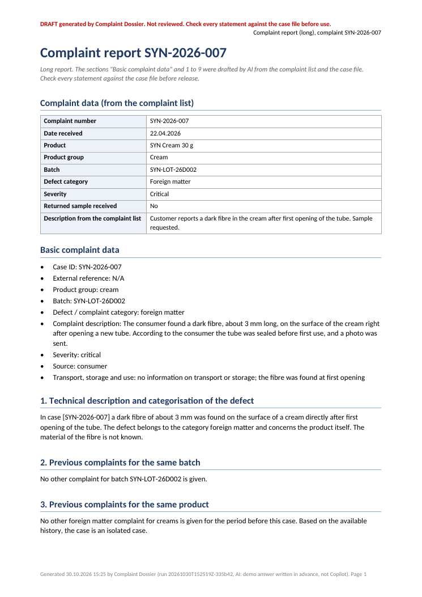

# Complaint Dossier

Complaint Dossier drafts one Word report per product complaint from an Excel complaint list with Microsoft 365 Copilot. Every report stays a DRAFT until a named reviewer has checked and approved it.

Writing each report by hand means reading the complaint's row, looking up earlier complaints for the same batch and product, reading the case folder and writing the same structure again. The tool does the preparation: it builds one prompt per complaint from that row, the similar complaints and the case folder, lets Copilot draft the report and writes it to Word.

Status: the demo mode is tested in CI on every push. It uses prewritten answers instead of Copilot. The live path through the Copilot desktop app completed one full round trip on 30 October 2026, but not yet with the final code ([details](#live-copilot-test-30-october-2026)).

[Sample report (PDF)](docs/sample/complaint-dossier-sample-DRAFT.pdf) · [all files of the sample run](docs/sample/) · [Design note: intended use, GAMP 5, risks, what validation would still need](docs/design-note.md)

**Kurzfassung (Deutsch):** PowerShell-Werkzeug, das aus einer Reklamationsliste in Excel für jede einzelne Reklamation einen Berichtsentwurf erstellt. Pro Fall baut es einen Prompt aus der Zeile der Liste, ähnlichen Reklamationen (gleiche Charge, gleiche Produktgruppe und Kategorie) und den Dokumenten des Fallordners. Microsoft 365 Copilot entwirft den Bericht (Kurz- oder Langbericht), das Werkzeug schreibt ihn als Word-Datei mit eigenem Audit-Log (SHA-256-Hashes). Jeder Bericht bleibt ein Entwurf, bis eine prüfende Person ihn einzeln freigibt. Nur die Reklamationen selbst gehören zum Reklamationsprozess; das Werkzeug bereitet Entwürfe vor. Der Demo-Modus ist in CI getestet. Der Live-Ablauf mit der Copilot-App lief am 30.10.2026 einmal vollständig durch; die Bestätigung mit dem endgültigen Code steht noch aus. Entworfen nach den Grundsätzen von GAMP 5; nicht validiert. Alle Beispieldaten sind synthetisch.


## Try it

Needs PowerShell 7 (Windows, Linux or macOS) or Windows PowerShell 5.1. No Excel, Word or Copilot needed for the demo.

```powershell
git clone https://github.com/vassiljevnikita-sudo/complaint-dossier
cd complaint-dossier
./Invoke-ComplaintDossier.ps1 -Demo
./Approve-ComplaintDossier.ps1 -Path out/<run id>/SYN-2026-007 -Reviewer 'Your Name'
```

The demo reads the synthetic complaint list in `samples/` (10 complaints, 6 of them open, invented batch numbers like `SYN-LOT-26A019`) and drafts one report for each open complaint, using a prewritten answer per case instead of Copilot. CI runs the same command on every push. Two of the reports from such a run are committed in [docs/sample/](docs/sample/), so you can read them without running anything.

## My role

Complaint Dossier is a public rebuild of a tool I first built in my working-student job in pharmaceutical quality assurance. There it turned the complaint list into individual complaint report drafts, and I reviewed each report before it was used. For this version I set the requirements and the scope. The two report prompts follow the structure and rules of the prompts I wrote for the original tool, translated into English, with everything company-specific removed. An AI coding agent (Claude) wrote the code, tests and documentation, and the commits name it as co-author. The data is synthetic and the report template is neutral.

## Tech stack

PowerShell 7 or Windows PowerShell 5.1 (the demo runs on either; the live Copilot automation always runs in Windows PowerShell 5.1), OpenXML read and written directly (no Office COM), Windows UI Automation for the Microsoft 365 Copilot desktop app, Pester 5, GitHub Actions on `windows-latest`, gitleaks.

## Limitations

- A prototype, designed along GAMP 5 principles. It is not validated, and the reviewer name is typed, not an authenticated electronic signature. See [docs/design-note.md](docs/design-note.md).
- The live Copilot path drives the app's user interface. App updates or another UI language can break it. CI cannot test it, because GitHub runners have no Copilot licence. The full live round trip has worked once, with an earlier version of the prompts; see [What is tested where](#what-is-tested-where).
- The prompts carry process rules from the original workflow, set in `config.example.json` under `Reports.*.ProcessFacts` (for example "The batch record was reviewed and showed no findings."). Copilot treats them as facts for every report. Replace them with what your own process guarantees before any real use.
- Each audit.json detects changed files through SHA-256 hashes, but it is an ordinary file without access control. Approval reads the results of the automated checks from it, so whoever can edit that file can also hide a failed check.
- Masking covers the case description and the case document text inserted into the prompt, and there it removes only e-mail addresses and phone numbers. Uploaded files are sent to Copilot unchanged and must be reviewed or redacted separately. Masking is not anonymisation.

## How to run

### Demo mode

`./Invoke-ComplaintDossier.ps1 -Demo` reads `config.example.json`, selects the open complaints and writes one folder per complaint under `out/<run id>/`:

| File in `out/<run id>/<case id>/` | Content |
| --- | --- |
| `<case id>-short-report-DRAFT.docx` or `<case id>-long-report-DRAFT.docx` | The report: run data, complaint record, similar complaints, case documents, AI-drafted report text, automated checks, approval block |
| `prompt.txt` | The exact prompt for this case, as it would go to Copilot |
| `response.md` | The answer (in demo mode the prewritten sample for this case) |
| `case-data.json` | The complaint row, the similar complaints and frequency level the tool computed, required sentences, document names |
| `audit.json` | SHA-256 of every input and output of this report, timestamps, checks, reviewer field |

`out/<run id>/run.json` lists which complaints were drafted, skipped or failed in the run.



### Which complaints get a report

- Without `-CaseId`: every complaint whose status is listed in `Selection.OpenStatuses` (default `Open`). With `-CaseId SYN-2026-006,SYN-2026-007`: exactly these, whatever their status.
- The report type comes from an empty marker file in the case folder: `short.txt` for a short report, `long.txt` for a long report. A complaint without a marker is skipped; both markers at once is an error.
- A complaint that already has an approved report under `Report.OutputPath` is skipped.
- Complaints run one after another. If one fails, for example because Copilot did not answer, the others still run, and the run ends with exit code 2.

### Short and long report

Both prompts are in `prompts/`. They ask for fixed headings in a fixed order, a list of basic complaint data and running text in the numbered sections.

| | Short report | Long report |
| --- | --- | --- |
| Sections | Basic complaint data, 1 to 4: defect, statistical and historical classification, assessment, conclusion | Basic complaint data, 1 to 9: defect, same batch, same product, returned sample, batch record, analyses and retained samples, manufacturing defect, corrective actions, risk and conclusion |
| Sentences the tool requires word for word | Section 2 opens with "The reported defect is classified as <level>.", with the frequency level the tool computed | "No complaint sample was available for the investigation." when the complaint list says no sample was received |
| Ending | | "The complaint is classified as justified." or "... not justified." |

The tool, not the model, computes the similar complaints: other complaints with the same batch in the whole list, and other complaints with the same product group and category in the 12 months up to the complaint. The frequency level (rare, occasional, frequent, very frequent) follows from that count; the thresholds are in `SimilarComplaints.FrequencyLevels`.

### Live mode with Microsoft 365 Copilot

Live mode needs Windows, the Microsoft 365 Copilot desktop app signed in with a Copilot licence, and an unlocked desktop that is shown on a screen (a minimised remote desktop window is not enough). Windows PowerShell 5.1 is enough; the UI automation always runs in it.

1. Copy `config.example.json` to `config.json`. `config.json` is in `.gitignore`.
2. Point `Workbook.Path` and `CaseFolders.Path` at your data. Relative paths resolve against the project folder.
3. Set `Copilot.PreferredModel` to the model name exactly as the Copilot model menu shows it. If the model sits in a submenu, put the submenu name into `Copilot.PreferredModelGroup`. If the menu does not offer the model, the run stops. It never falls back to another model.
4. Check the files that will be uploaded: by default every file with an extension from `Copilot.Upload.Extensions` in the case folder (set `Copilot.Upload.Path` to use `<path>/<case id>/` instead). They are sent unchanged, so review or redact them first.
5. Open the Copilot app, then run:

```powershell
./Invoke-ComplaintDossier.ps1 -Live -CaseId SYN-2026-006
```

For each complaint the tool opens a new temporary chat, selects the configured model, attaches that complaint's files through the app's own file dialog, sends the prompt, waits for the complete answer and copies it with the answer's copy button. Do not use mouse or keyboard while it runs. Each step is logged in `copilot-status.json` and in `audit.json` of the complaint. The app copies the answer as plain text, so a line that holds only a section name counts as that section's heading; `response.md` keeps the answer exactly as copied.

### Review and approval of each report

```powershell
./Approve-ComplaintDossier.ps1 -Path out/<run id>/SYN-2026-007 -Reviewer 'A. Reviewer' -Comment 'Checked against the case file.'
```

Each report is approved on its own. Approval recomputes the hashes of case data, prompt, response and draft report and refuses if anything changed after the run. It writes an approved copy without the DRAFT marking, adds reviewer, time and the new hash to that report's `audit.json`, and keeps the draft.

Approval also refuses while any automated check of the report has failed, for example when the answer cites a case ID that is not in the complaint list, misses a section or a required sentence, or does not end with a classification. It lists the failed checks, and the report stays DRAFT. Usually the right step is to draft the complaint again. If the reviewer decides the failure is acceptable, they have to say why:

```powershell
./Approve-ComplaintDossier.ps1 -Path out/<run id>/SYN-2026-007 -Reviewer 'A. Reviewer' -AcceptFailedChecks -Justification 'SYN-2026-099 is a typo for SYN-2026-009; checked against the complaint list.'
```

The justification must not be empty. The approved report then says "APPROVED WITH A DOCUMENTED EXCEPTION" and lists the accepted checks with the justification. `audit.json` stores the same under `review.exception`.

### Your own data

The workbook columns are mapped in `Workbook.Columns`, so the tool works with other column names. `CaseId`, `ReceivedDate`, `Category` and `Description` are required; `ProductGroup`, `Batch`, `Severity`, `Status` and `SampleReceived` are optional. Each complaint has a case folder `<CaseFolders.Path>/<case id>/` with its documents and the report type marker; text files (`CaseFolders.TextExtensions`) go into the prompt. The prompts live in `prompts/`, the report layout in `templates/report-template.docx` (regenerate it with `tools/New-ReportTemplate.ps1`, or use your own .docx with a `{{REPORT_BODY}}` paragraph). `tools/New-SyntheticCases.ps1` regenerates the sample data.

## What is tested where

| What | Where | How |
| --- | --- | --- |
| Excel reading, case selection (open cases, `-CaseId`, markers, approved reports skipped), similar complaints and frequency level, per-case prompt, masking, uploads per case, response checks, report, audit hashes, per-report approval and its refusals | CI, `windows-latest`, every push | Pester 5 under PowerShell 7 (`tests/`) |
| Model selection logic, including abort on a missing model or group | CI | Pester with mocked UI elements |
| Round-trip script aborts cleanly without a model and without a Copilot window | CI | Pester, starts the script in Windows PowerShell 5.1 |
| Demo run of all 6 open complaints, and approval of one report under Windows PowerShell 5.1 | CI | Workflow steps |
| Demo reports as downloadable .docx files | CI | Artifact `complaint-dossier-demo` (needs a GitHub login) |
| Committed samples in `docs/sample/` still match what the code produces | CI | Pester compares the report text and the hashes in each audit.json |
| Employer denylist and secrets over the full history | CI | Denylist from a repository secret, gitleaks |
| Live Copilot round trip | Manual, see below | Not reproducible in CI |

### Live Copilot test (30 October 2026)

Run against the Microsoft 365 Copilot desktop app (German UI) under Windows PowerShell 5.1, with the model "Quick Response" and synthetic cases only.

- An earlier version stopped at the temporary-chat toggle. The tool aborted as designed and sent nothing. Fixed.
- Run 1, case SYN-2026-006: new temporary chat, model selection, upload of the case's CSV file and sending the prompt passed. The tool then copied the prompt instead of the answer, because the answer's copy button was below the visible area. The answer is now taken from the last copy button in the chat.
- Run 2, case SYN-2026-006: the full round trip worked end to end without any user input. New temporary chat, model selected and confirmed, CSV uploaded, prompt sent, answer copied, DRAFT Word report and audit.json written. One automated check failed: the app copies the answer as plain text, so the Markdown headings were missing. Lines that hold only a section name now count as headings.
- After run 2 the prompts were replaced with the versions adapted from the original tool. Two further runs with the final code (cases SYN-2026-006 and SYN-2026-007) did not finish: the Copilot window turned blank and could not be brought to the foreground, most likely because the remote desktop session was not displayed. In the last run nothing was sent.

So the live path has worked once end to end; confirmation with the final code and prompts is still pending. Until then, treat live mode as not confirmed.

## Project layout

```text
Invoke-ComplaintDossier.ps1     entry point: -Demo or -Live, all open cases or -CaseId
Approve-ComplaintDossier.ps1    reviewer approval of one report
src/ComplaintDossier.psm1       Excel reading, case selection, similar complaints, prompt, checks, Word report, audit, approval
src/Copilot/                    UI automation for the Copilot desktop app (Windows PowerShell 5.1)
prompts/                        short and long report prompt
templates/                      neutral Word template
samples/                        synthetic complaint list, case folders with markers, one prewritten answer per open case
tools/                          generators for the sample data and the Word template
tests/                          Pester tests
docs/design-note.md             intended use, GAMP 5 reasoning, risks, what validation would still need
docs/sample/                    two reports of one CI demo run: DRAFT .docx and PDF, audit.json, prompt, answer, case data
```

## License

MIT, see [LICENSE](LICENSE).
